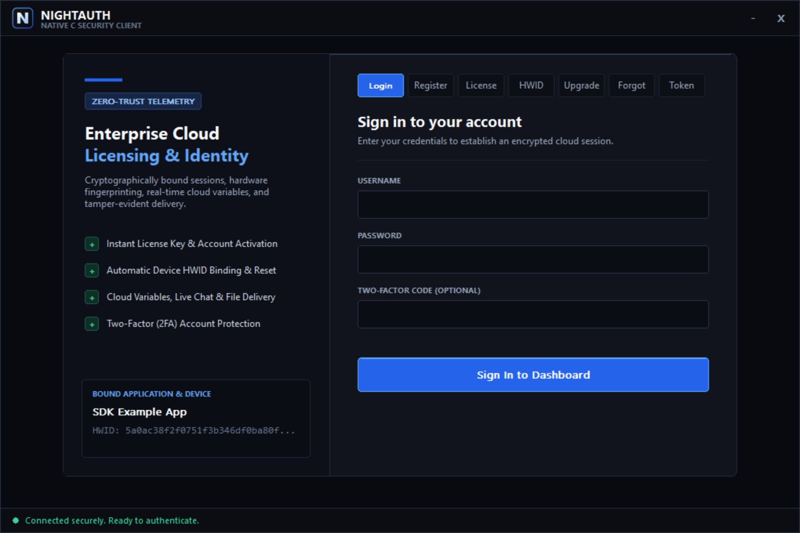
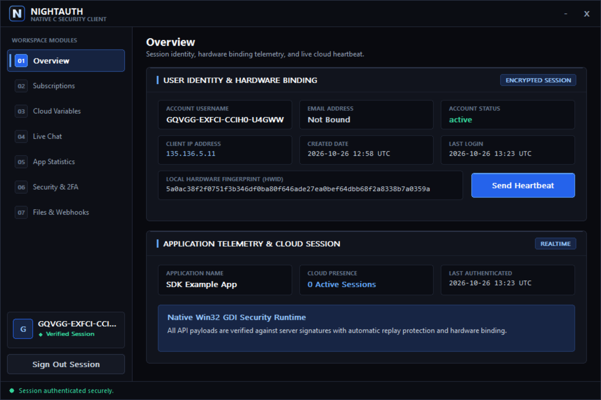
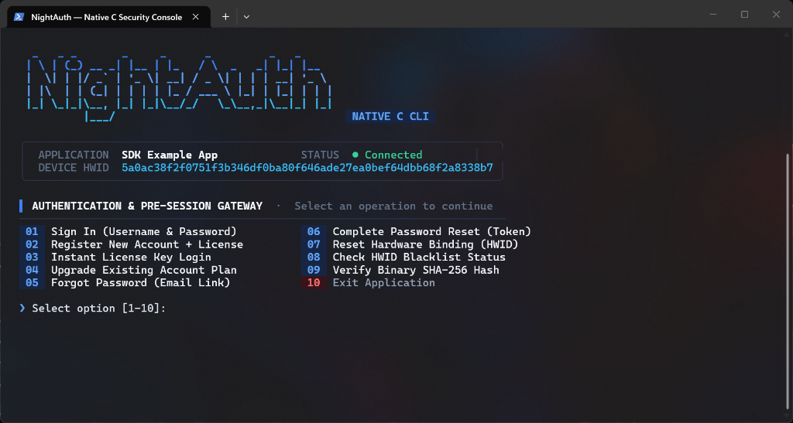
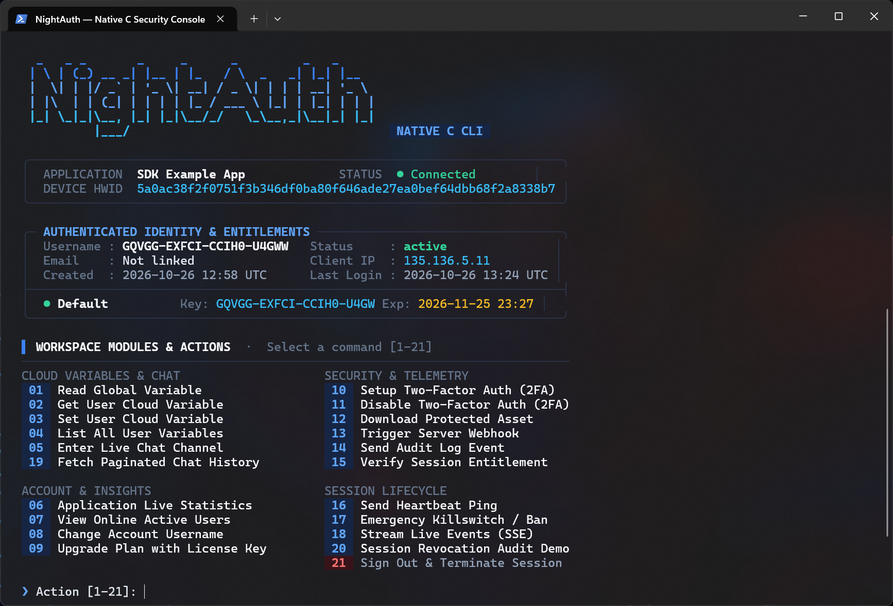

# NightAuth C SDK — Mettez-nous une étoile sur GitHub ⭐

SDK Header-Only officiel **NightAuth** C11 et suite de clients de référence (Interface graphique moderne **Win32 Pure GDI+** et CLI interactif pour terminal). Protégez vos logiciels natifs C contre l'ingénierie inverse et le piratage en quelques minutes.

Official Portal: [https://nightauth.org](https://nightauth.org)
---

**Languages / Idiomas / Langues / Sprachen:**  
[English](../README.md) • [Español](es.md) • [Français](fr.md) • [Deutsch](de.md) • [Italiano](it.md) • [Português](pt.md) • [Русский](ru.md) • [Türkçe](tr.md) • [Polski](pl.md) • [中文](zh.md)

---

> [!NOTE]
> ### 📺 Tutoriels Vidéo & Guides de Déploiement
> Les tutoriels vidéo officiels et les guides pas-à-pas détaillant la configuration des applications, plans, abonnements, variables cloud, webhooks et licences sur le tableau de bord NightAuth **seront publiés prochainement** sur notre portail et chaîne officielle.

---

## 📸 Captures d'écran

### Application de Bureau (Native Win32 GDI Thème Sombre Moderne)

| Écran d'Authentification / Connexion | Tableau de Bord & Abonnements |
| :---: | :---: |
|  |  |

### Application Console (Terminal Interactif)

| Connexion Console | Tableau de Bord Interactif |
| :---: | :---: |
|  |  |

---

## 🛡️ Pratiques de Sécurité Recommandées

* **Virtualisation de Binaires Natifs :** Les binaires C natifs sont vulnérables à l'analyse statique via IDA Pro, Ghidra et Binary Ninja. Pour les versions de production, protégez les exécutables compilés à l'aide de virtualiseurs et de protecteurs commerciaux tels que **VMProtect**, **Themida** ou **CodeVirtualizer**.
* **Chiffrement des Chaînes à la Compilation :** Ne laissez pas de chaînes sensibles ou de jetons d'API en clair dans la section `.rdata`. Utilisez des macros d'offuscation de chaînes XOR pour déchiffrer les chaînes uniquement au moment requis.
* **Exécution Sécurisée en Mémoire :** Lors du streaming de payloads ou de DLLs protégés via `nightauth_download_file(api, ticket, ...)`, **n'écrivez jamais les octets sur le disque physique**. Chargez et exécutez les charges utiles directement depuis la mémoire RAM (par ex. chargement PE réflectif ou injection de mappe manuelle) et effacez immédiatement le tampon avec `SecureZeroMemory()`.
* **Vérification du Matériel et de l'Intégrité :** Maintenez actives les vérifications anti-débogage, l'intégrité de la mémoire et les contrôles temporels dans les versions de production pour limiter l'accrochage à l'exécution.

---

## 📦 Prérequis et Compilation

Nécessite **C11** ou supérieur et **Visual Studio 2026** (MSVC toolset `v145`). Les projets fournis sont configurés pour `v145` : le projet console fixe `<PlatformToolset>v145</PlatformToolset>` de manière inconditionnelle, tandis que le projet desktop n'utilise `v145` par défaut que lorsqu'aucun toolset n'est spécifié. Compiler avec **Visual Studio 2022** (`v143`) ne fonctionne que si vous changez manuellement le toolset dans `console/NightAuth-Console.vcxproj` (ou si vous passez `/p:PlatformToolset=v143` pour le client desktop).

Dépendances Windows :
* `ws2_32.lib`, `crypt32.lib`, `bcrypt.lib`, `advapi32.lib` (Cryptographie et sockets natifs Windows)
* `gdi32.lib`, `msimg32.lib`, `comctl32.lib`, `user32.lib`, `shell32.lib` (Rendu de l'interface graphique de bureau)
* Inclus `libcurl` et `LibreSSL` (compatible OpenSSL, en-têtes sous `include/openssl/`) (dans `deps/curl_win64`)

> [!NOTE]
> L'en-tête du SDK utilise `<stdatomic.h>` (atomiques C11). Lors de l'intégration de `sdk/nightauth.h` dans votre propre projet MSVC, ajoutez l'option de compilation `/experimental:c11atomics` (les deux fichiers `.vcxproj` fournis la définissent déjà). Sans elle, MSVC ne peut pas compiler les opérations atomiques utilisées par la couche de session chiffrée.

### Compiler la solution avec MSBuild

```bash
MSBuild.exe NightAuth.sln /p:Configuration=Release /p:Platform=x64
```

### Déploiement à l'exécution

Les deux projets clients sont liés à la **bibliothèque d'importation** de libcurl (`libcurl.dll.a`), donc le DLL `libcurl-x64.dll` (de `deps/curl_win64/curl-8.23.0_5-win64-mingw/bin`) **doit être distribué à côté des fichiers `.exe` compilés**, sinon les clients ne démarrent pas. Le projet desktop lie en outre `shell32.lib`.

---

## ⚙️ Configuration & Initialisation

Définissez vos identifiants d'application depuis le tableau de bord NightAuth :

```c
#define NIGHTAUTH_IMPLEMENTATION
#include "sdk/nightauth.h"

// Application Configuration (from NightAuth Dashboard)
#define APP_NAME    ""
#define APP_API_KEY ""
#define APP_VERSION "1.0"
#define APP_TOKEN   NULL

// Initialize application handle
NightAuthApi* api = nightauth_create(
    APP_NAME,
    APP_API_KEY,
    APP_VERSION,
    APP_TOKEN,
    NULL
);
```

### Initialiser le Handshake Cryptographique (`init`)

Vous devez appeler `init()` avant toute autre fonction. Il initialise l'échange de clés Diffie-Hellman (X25519) et la session chiffrée :

```c
nightauth_init(api);

NightAuthResponse* resp = nightauth_get_response(api);
if (!resp->success) {
    fprintf(stderr, "Initialization failed: %s\n", resp->message);
    nightauth_destroy(api);
    return 1;
}
```

---

## 🚀 Guide d'Utilisation du SDK

### 1. Vérification de Session & Liste Noire

```c
// Validate active session status with the server
if (nightauth_check(api)) {
    printf("Session active.\n");
}

// Check if client HWID or IP address is blacklisted
bool blacklisted = false;
if (nightauth_check_blacklist(api, NULL, &blacklisted) && blacklisted) {
    fprintf(stderr, "Access Denied: Machine or IP is blacklisted.\n");
    return 1;
}
```

### 2. Connexion avec Identifiant & Mot de Passe (et 2FA)

```c
if (nightauth_login(api, username, password, totp_code)) {
    NightAuthUserData* user = nightauth_get_user(api);
    printf("Welcome back, %s!\n", user->username);
    printf("Hardware ID: %s\n", user->hwid);
    printf("Client IP:   %s\n", user->ip);

    for (int i = 0; i < user->subscription_count; i++) {
        printf("Plan: %s | Expires: %s | Key: %s\n",
               user->subscriptions[i].subscription,
               user->subscriptions[i].expiry,
               user->subscriptions[i].key);
    }
} else {
    fprintf(stderr, "Login failed: %s\n", nightauth_get_response(api)->message);
}
```

### 3. Inscription avec Clé de Licence

```c
if (nightauth_register(api, username, password, license_key, email)) {
    printf("Registered successfully: %s\n", nightauth_get_user(api)->username);
} else {
    fprintf(stderr, "Registration failed: %s\n", nightauth_get_response(api)->message);
}
```

### 4. Authentification par Clé Seule (Key Only)

```c
if (nightauth_license(api, license_key)) {
    printf("License verified successfully. Access granted.\n");
} else {
    fprintf(stderr, "Access denied: %s\n", nightauth_get_response(api)->message);
}
```

### 5. Mise à Niveau d'Abonnement (Upgrade)

```c
if (nightauth_upgrade(api, username, new_license_key)) {
    printf("Subscription upgraded successfully.\n");
} else {
    fprintf(stderr, "Upgrade failed: %s\n", nightauth_get_response(api)->message);
}
```

### 6. Réinitialisation de l'Identifiant Matériel (HWID Lock)

```c
if (nightauth_reset_hwid(api, username, password, totp_code)) {
    printf("HWID reset successfully. You can now log in on this machine.\n");
} else {
    fprintf(stderr, "HWID reset failed: %s\n", nightauth_get_response(api)->message);
}
```

### 7. Mot de Passe Oublié (Forgot Password & Reset)

```c
// Request password reset email
if (nightauth_forgot_password(api, email)) {
    printf("Password recovery email sent. Check your inbox.\n");
}

// Complete password reset with token
if (nightauth_reset_password(api, token, new_password)) {
    printf("Password reset successfully.\n");
}
```

### 8. Données du Profil Utilisateur (`result.ToUserData()`)

```c
NightAuthUserData* user = nightauth_get_user(api);

printf("Username:    %s\n", user->username);
printf("Client IP:   %s\n", user->ip);
printf("Hardware ID: %s\n", user->hwid);
printf("Registered:  %s\n", user->created_at);
printf("Last Login:  %s\n", user->last_login_at);

for (int i = 0; i < user->subscription_count; i++) {
    printf("Plan: %s | Expires: %s | Key: %s\n",
           user->subscriptions[i].subscription,
           user->subscriptions[i].expiry,
           user->subscriptions[i].key);
}
```

### 9. Variables Cloud (Globales)

```c
char motd[256] = {0};
if (nightauth_get_global_var(api, "server_motd", motd, sizeof(motd))) {
    printf("Cloud Variable: %s\n", motd);
}
```

### 10. Variables Utilisateur (User Variables)

```c
// Set a user variable
bool set_ok = nightauth_set_user_var(api, "discord_tag", "user#0001");

// Retrieve a user variable
char tag[128] = {0};
if (nightauth_get_user_var(api, "discord_tag", tag, sizeof(tag))) {
    printf("Stored Discord: %s\n", tag);
}

// Retrieve multiple user variables
NightAuthUserVar vars[32];
int total = nightauth_get_user_variables(api, vars, 32);
for (int i = 0; i < total; i++) {
    printf("%s = %s\n", vars[i].key, vars[i].value);
}
```

### 11. Journaux d'Audit & Sécurité

```c
nightauth_log(api, "Suspicious memory modification attempt detected.");
```

### 12. Bannissement d'Utilisateur & Machine

```c
nightauth_ban(api, "Security tampering detected by Anti-Cheat.");
```

### 13. Webhooks Côté Serveur Sécurisés

```c
int status = 0;
const char* payload = "{\"content\":\"Client notification\"}";

if (nightauth_webhook(api, "7kR0UedlVI", payload, NULL, &status)) {
    printf("Webhook Response Status: HTTP %d\n", status);
}
```

### 14. Téléchargement Sécurisé en Mémoire

Les téléchargements de fichiers nécessitent un **ticket d'accès à périmètre** obtenu avec `nightauth_access_ticket()` (le serveur valide le ticket avant de servir le fichier) :

```c
// Demander un ticket d'accès à périmètre pour le fichier cible (périmètre "file")
char ticket[128] = {0};
int64_t expires_in = 0;
if (!nightauth_access_ticket(api, "file", "385624", ticket, sizeof(ticket), &expires_in)) {
    fprintf(stderr, "Ticket d'accès refusé : %s\n", nightauth_get_response(api)->message);
    return 1;
}

char file_name[128] = {0};
uint8_t file_buf[65536];
size_t downloaded_len = 0;

if (nightauth_download_file(api, ticket, file_name, file_buf, sizeof(file_buf), &downloaded_len)) {
    printf("%s (%zu octets) téléchargé de manière sécurisée.\n", file_name, downloaded_len);
    // Traiter ou exécuter le payload directement en mémoire (Reflective PE / Shellcode)
    // Effacer le tampon en mémoire de manière sécurisée après l'exécution
    SecureZeroMemory(file_buf, downloaded_len);
}
```

### 15. Canaux de Chat en Direct

```c
// Send a message to a channel
nightauth_send_chat_message(api, "Hello community!", "general");

// Fetch latest messages
NightAuthChatMessage msgs[50];
int msg_count = nightauth_get_chat_messages(api, "general", msgs, 50);
for (int i = 0; i < msg_count; i++) {
    printf("[%s]: %s\n", msgs[i].author, msgs[i].message);
}
```

### 16. Gestionnaires d'Événements Temps Réel (SSE)

```c
static bool handle_event(const char* event_json, void* user_data) {
    printf("[EVENT] %s\n", event_json);
    return true; // Return true to keep stream alive
}

nightauth_events_run(api, "ticket_value", NULL, handle_event, NULL);
```

### 17. Authentification à Deux Facteurs (2FA)

```c
// Setup TOTP 2FA
NightAuthTwoFactorSetupData setup;
if (nightauth_setup_2fa(api, &setup)) {
    printf("2FA Secret: %s\n", setup.secret);
    printf("QR URI:     %s\n", setup.uri);
}

// Confirm with 6-digit Authenticator code
NightAuthTwoFactorConfirmData conf;
nightauth_confirm_2fa(api, "123456", &conf);

// Disable 2FA
nightauth_disable_2fa(api, password, "123456");
```

### 18. Cycle de Vie de Session & Déconnexion

```c
// Heartbeat ping to keep session alive
nightauth_heartbeat(api);

// Revoke and terminate session
nightauth_logout(api);

// Release memory allocations
nightauth_destroy(api);
```

### 19. Configuration avancée du client

```c
// Délai d'attente par requête en millisecondes (affecte tous les appels réseau ultérieurs)
nightauth_set_request_timeout(api, 15000);

// Autoriser HTTP non chiffré pour les endpoints de développement loopback/self-hosted
NightAuthApi* api_dev = nightauth_create_ex(
    APP_NAME, APP_API_KEY, APP_VERSION, APP_TOKEN,
    "http://127.0.0.1:8787/api/v1",   // URL d'API personnalisée (NULL = valeur par défaut)
    true                               // allow_insecure_loopback
);

// Inspecter ou faire pivoter l'identité (nom, clé api, version) d'un handle actif
char cur_name[128], cur_key[128], cur_ver[32];
nightauth_get_identity(api, cur_name, sizeof(cur_name), cur_key, sizeof(cur_key), cur_ver, sizeof(cur_ver));
nightauth_set_identity(api, "MyApp", "new_api_key", "1.1");
```

### 20. Clés publiques du serveur & constantes par défaut

Le SDK épingle les clés publiques de signature et de sealed-box du serveur. Les valeurs par défaut sont fournies en tant que constantes de compilation (`NIGHTAUTH_DEFAULT_API_URL`, `NIGHTAUTH_DEFAULT_SIGNING_PUBLIC_KEY`, `NIGHTAUTH_DEFAULT_SEALED_BOX_PUBLIC_KEY` dans `sdk/nightauth.h`), et l'implémentation exporte des copies modifiables (`NIGHTAUTH_SERVER_SIGNING_PUBLIC_KEY`, `NIGHTAUTH_SERVER_SEALED_BOX_PUBLIC_KEY`) que les opérateurs self-hosted peuvent remplacer par handle :

```c
// Diriger un handle vers une instance NightAuth self-hosted avec ses propres clés
nightauth_set_server_keys(api,
    "a1b2c3...",   // clé publique de signature (64 caractères hex)
    "d4e5f6...");  // clé publique de sealed-box (64 caractères hex)
```

### 21. Connexion par licence avec 2FA (`nightauth_license_with_totp`)

Pour les comptes dont le flux de licence impose TOTP, passez le code de l'application d'authentification avec la clé de licence :

```c
if (nightauth_license_with_totp(api, license_key, "123456")) {
    printf("Licence vérifiée avec 2FA. Accès accordé.\n");
}
```

### 22. Changer le nom d'utilisateur

Nécessite le mot de passe actuel. **Remarque :** pour des raisons de sécurité, le serveur ferme la session après un renommage réussi — reconnectez-vous avec le nouveau nom.

```c
if (nightauth_change_username(api, "new_username", password)) {
    printf("Nom d'utilisateur changé en %s. Veuillez vous reconnecter.\n",
           nightauth_get_user(api)->username);
}
```

### 23. Vérifier le hachage d'un fichier

Valide une somme de contrôle SHA-256 de votre binaire distribué contre le registre côté serveur des versions autorisées :

```c
if (nightauth_verify_file_hash(api, "a1b2c3d4...")) {
    printf("Intégrité vérifiée : la somme correspond à une version autorisée.\n");
} else {
    fprintf(stderr, "Vérification échouée : %s\n", nightauth_get_response(api)->message);
}
```

### 24. Télémétrie de l'application & utilisateurs en ligne

```c
// Statistiques agrégées de l'application
NightAuthAppStats stats;
if (nightauth_get_stats(api, &stats)) {
    printf("Utilisateurs : %lld (actifs %lld, bannis %lld)\n",
           (long long)stats.total_users, (long long)stats.active_users, (long long)stats.banned_users);
    printf("Licences : %lld utilisées / %lld inutilisées | Version : %s\n",
           (long long)stats.used_licenses, (long long)stats.unused_licenses, stats.version);
}

// Utilisateurs actuellement en ligne (renvoie le nombre de noms écrits)
char online[16][128];
int64_t total_online = 0;
int count = nightauth_get_online_users(api, &total_online, online, 16);
for (int i = 0; i < count; i++) {
    printf("En ligne : %s\n", online[i]);
}

// Métadonnées statiques de l'application (nom, version, totaux)
NightAuthAppData* app = nightauth_get_app(api);
printf("App : %s %s | Utilisateurs : %lld | En ligne : %lld\n",
       app->application, app->version, (long long)app->total_users, (long long)app->online_users);
```

### 25. Gestion du Hardware ID (HWID)

```c
// Lire l'empreinte machine calculée par le SDK
char hwid[128] = {0};
nightauth_get_hardware_id(hwid, sizeof(hwid));

// Lier le handle de session actuel à un HWID explicite
nightauth_set_hardware_id(api, hwid);

// Remplacer globalement l'empreinte rapportée par tous les futurs handles
// (utile pour les tests ou les schémas d'empreinte personnalisés)
nightauth_set_hardware_id_override("custom-machine-id");
```

### 26. Historique de chat paginé (`nightauth_get_chat_messages_ex`)

Récupère les messages plus anciens qu'un ID donné (passez `0` pour la page la plus récente) et les marque optionnellement comme lus côté serveur :

```c
NightAuthChatMessage hist[25];
int count = nightauth_get_chat_messages_ex(api, "general", 0, true, hist, 25);
for (int i = 0; i < count; i++) {
    printf("[%s] %s : %s (#%s)\n", hist[i].timestamp, hist[i].author, hist[i].message, hist[i].id);
}
```

### 27. Webhooks serveur avancés (`nightauth_webhook_ex`)

Webhook étendu avec paramètres de requête, pièce jointe optionnelle et sortie du statut HTTP :

```c
int status = 0;
const char* json = "{\"content\":\"Client notification\"}";
const void* report_data = NULL;   // octets de la pièce jointe optionnelle
size_t report_len = 0;

if (nightauth_webhook_ex(api, "7kR0UedlVI", "Client notification",
                         "urgent=true", json,
                         report_data, report_len, "report.bin", &status)) {
    printf("Webhook déclenché : HTTP %d\n", status);
}
```

### 28. Streaming d'événements avancé (`events_run_ex`, `events_cancel`)

`nightauth_events_run_ex` délivre chaque événement SSE avec son ID d'événement serveur (permettant la reprise via `last_event_id`). `nightauth_events_cancel` interrompt un flux en cours depuis un autre thread (par exemple sur saisie utilisateur) :

```c
static bool handle_event_ex(const char* event_json, const char* event_id, void* user) {
    printf("[EVENT %s] %s\n", event_id ? event_id : "-", event_json);
    return true; // Renvoyer true pour garder le flux actif
}

// Un autre thread peut appeler nightauth_events_cancel(api) pour arrêter la boucle
if (nightauth_events_run_ex(api, ticket, NULL, handle_event_ex, NULL)) {
    printf("Flux d'événements fermé proprement.\n");
}
```

### 29. Auto-mises à jour signées & vérifiées

Vérifie une enveloppe de mise à jour signée contre une clé publique Ed25519 épinglée, la télécharge, ou transmet l'URL vérifiée au flux d'application assisté par le serveur :

```c
// 1. Vérifier un manifeste de mise à jour signé reçu du serveur
NightAuthVerifiedUpdate update;
char err[256] = {0};
if (nightauth_signed_update_verify(envelope_json, NIGHTAUTH_DEFAULT_SIGNING_PUBLIC_KEY,
                                   "MyApp", /*min_sequence=*/1, &update, err, sizeof(err))) {
    printf("Mise à jour v%s -> seq %llu (%llu octets)\n", update.version,
           (unsigned long long)update.sequence, (unsigned long long)update.size);

    // 2. Télécharger l'artefact vérifié sur le disque
    if (nightauth_signed_update_download(&update, "update.pkg", err, sizeof(err))) {
        printf("Mise à jour téléchargée et digest vérifié.\n");
    }
}

// 3. Ou télécharger l'installateur officiel directement depuis une URL de manifeste
nightauth_signed_update_installer_download(manifest_url, NIGHTAUTH_DEFAULT_SIGNING_PUBLIC_KEY,
                                           "MyApp", "installer.exe", err, sizeof(err));

// 4. Application assistée par le serveur : transmettre l'URL de téléchargement en attente au handle API
if (nightauth_apply_update(api, download_url)) {
    printf("Version requise : %s\n", nightauth_get_required_version(api));
}
const char* pending = nightauth_get_pending_download_url(api); // NULL si aucune en attente
```

---

## 🖥️ Exécuter les clients Console et Bureau

```bash
# Build Solution
MSBuild.exe NightAuth.sln /p:Configuration=Release /p:Platform=x64

# Interactive Terminal Console Client
./console/bin/Release/NightAuth-Console.exe

# Native Modern Win32 Desktop GUI Client
./desktop/bin/Release/NightAuth-Desktop.exe
```

---

## 📄 Licence

Ce projet est sous licence **Elastic License 2.0**.

* Vous ne pouvez pas fournir le logiciel à des tiers en tant que service hébergé ou géré.
* Vous ne pouvez pas altérer, désactiver ou contourner le système de licences.
* Vous ne pouvez pas modifier ou supprimer les mentions de droit d'auteur.

Consultez le fichier [LICENSE](../LICENSE) pour le texte légal complet.
